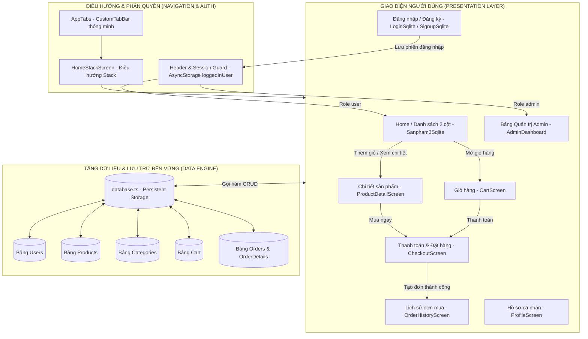

# Mobile---Shop-App

# BÁO CÁO KỸ THUẬT & TÀI LIỆU DỰ ÁN SHOP APP (REACT NATIVE)

> **Dự án:** Ứng dụng Di động Bán hàng Shop App (`VIE TECH SHOP`)  
> **Nền tảng:** React Native, TypeScript, React Navigation v6, AsyncStorage / Persistent Storage Engine.  
> **Thư mục:** `D:\Mobile 2\Mobile\ShopApp`  
> **Cập nhật:** 10/11/2026  

---

## 🚀 Hướng Dẫn Chạy Nhanh (Quick Start)

### 1. Khởi chạy ứng dụng
- **Cách 1 (Tự động 1-click):** Chạy file [`Chay_App.bat`](../../Chay_App.bat) ở thư mục gốc `D:\Mobile 2`. Script sẽ tự động xóa lock file, khởi động máy ảo Android và mở ứng dụng.
- **Cách 2 (Thủ công):**
  ```bash
  # Bước 1: Khởi động Metro Bundler
  npx react-native start --reset-cache

  # Bước 2: Chạy trên Android Emulator
  npx react-native run-android
  ```

### 2. Tài khoản kiểm thử mặc định
| Loại tài khoản | Tên đăng nhập | Mật khẩu | Quyền hạn (Role) | Chức năng nổi bật |
| :--- | :--- | :--- | :--- | :--- |
| **Quản trị viên (Admin)** | `admin` | `123456` | `admin` | Truy cập **⚡ Quản trị**: Xử lý đơn hàng, duyệt đơn, CRUD sản phẩm, danh mục, phân quyền user. |
| **Khách hàng (User)** | `user1` | `password123` | `user` | Mua hàng, xem chi tiết, giỏ hàng, đặt hàng thanh toán COD, lịch sử đơn mua. |

---

## 1. TỔNG QUAN KIẾN TRÚC & BẢNG MA TRẬN CHỨC NĂNG

### 1.1. Bảng tra cứu chức năng theo File & Dòng Code

| STT | Tên Chức Năng | File Chịu Trách Nhiệm | Dòng Code Cụ Thể | Thành Phần / Hàm Chính |
| :--- | :--- | :--- | :--- | :--- |
| **1** | **Hiển thị sản phẩm (Grid 2 cột)** | [`Sanpham3Sqlite.tsx`](./Sanpham3Sqlite.tsx) | `L620 - L740` | `FlatList` (`numColumns={2}`), thẻ sản phẩm, tính toán responsive |
| **2** | **Xem chi tiết sản phẩm** | [`ProductDetailScreen.tsx`](./ProductDetailScreen.tsx) | `L20 - L280` | `ProductDetailScreen`, `getImageSource()`, bộ chọn số lượng |
| **3** | **Tìm kiếm theo tên & danh mục (Smart Search)** | [`Sanpham3Sqlite.tsx`](./Sanpham3Sqlite.tsx)<br>[`database.ts`](./database.ts) | `L325 - L365`<br>`L470 - L550` | `searchKeyword`, tìm khớp theo tên SP, mô tả và tên danh mục |
| **4** | **Lọc sản phẩm theo danh mục** | [`Sanpham3Sqlite.tsx`](./Sanpham3Sqlite.tsx)<br>[`ProductsByCategoryScreen.tsx`](./ProductsByCategoryScreen.tsx) | `L365 - L440`<br>`L20 - L169` | `selectedCategory`, danh sách chip ngang danh mục (`ScrollView`), nút bỏ chọn |
| **5** | **Lọc sản phẩm theo giá & Sắp xếp** | [`Sanpham3Sqlite.tsx`](./Sanpham3Sqlite.tsx)<br>[`database.ts`](./database.ts) | `L445 - L580`<br>`L485 - L570` | 5 mức giá định sẵn, tùy chỉnh khoảng giá Modal, sắp xếp Thấp → Cao / Cao → Thấp |
| **6** | **Thanh trạng thái bộ lọc đang chọn (Active Filters)** | [`Sanpham3Sqlite.tsx`](./Sanpham3Sqlite.tsx) | `L585 - L680` | Hiển thị tag badge danh mục, từ khóa, mức giá, nút `Xóa tất cả ↺` |
| **7** | **Thêm sản phẩm mới (User/Admin)** | [`Sanpham3Sqlite.tsx`](./Sanpham3Sqlite.tsx) | `L780 - L900` | `+ Thêm sản phẩm`, Modal form nhập liệu, `addProduct()` |
| **8** | **Chỉnh sửa sản phẩm** | [`Sanpham3Sqlite.tsx`](./Sanpham3Sqlite.tsx) | `L905 - L1020` | Nút `Sửa` trên thẻ sản phẩm, Modal cập nhật, `updateProduct()` |
| **9** | **Xóa sản phẩm** | [`Sanpham3Sqlite.tsx`](./Sanpham3Sqlite.tsx) | `L220 - L250` | Nút `Xóa`, hộp thoại `Alert.alert` xác nhận, `deleteProduct()` |
| **10** | **Giỏ hàng (Cart)** | [`CartScreen.tsx`](./CartScreen.tsx)<br>[`database.ts`](./database.ts) | `L1 - L405`<br>`L730 - L810` | `CartScreen`, `fetchCart`, `updateCartQuantity`, `removeFromCart` |
| **11** | **Thêm vào giỏ / Mua ngay** | [`Sanpham3Sqlite.tsx`](./Sanpham3Sqlite.tsx)<br>[`ProductDetailScreen.tsx`](./ProductDetailScreen.tsx) | `L250 - L290`<br>`L85 - L145` | Nút `+Giỏ`, nút `Mua ngay`, `addToCart()` |
| **12** | **Đặt hàng & Thanh toán (Checkout)** | [`CheckoutScreen.tsx`](./CheckoutScreen.tsx)<br>[`database.ts`](./database.ts) | `L1 - L393`<br>`L815 - L860` | `CheckoutScreen`, form giao hàng, phương thức COD, `createOrder()` |
| **13** | **Lịch sử mua hàng (User)** | [`OrderHistoryScreen.tsx`](./OrderHistoryScreen.tsx) | `L1 - L397` | Danh sách đơn hàng `#OD-...`, trạng thái, chi tiết các món đã mua |
| **14** | **Quản trị Dashboard (Tổng quan)** | [`AdminDashboard.tsx`](./AdminDashboard.tsx) | `L40 - L150`, `L460 - L550` | Kiểm tra quyền Admin, 4 thẻ thống kê (Users, Cats, Prods, Orders) |
| **15** | **Quản lý Người dùng (Admin)** | [`AdminDashboard.tsx`](./AdminDashboard.tsx) | `L155 - L220`, `L610 - L710` | Đổi vai trò `user` ↔ `admin`, xóa user, bảo vệ tài khoản gốc |
| **16** | **Quản lý Loại SP (Admin)** | [`AdminDashboard.tsx`](./AdminDashboard.tsx) | `L225 - L330`, `L715 - L830` | CRUD danh mục, Modal Thêm/Sửa, đếm số lượng SP thuộc danh mục |
| **17** | **Quản lý Sản phẩm (Admin)** | [`AdminDashboard.tsx`](./AdminDashboard.tsx) | `L335 - L430`, `L835 - L990` | CRUD sản phẩm, chọn danh mục, bộ chọn hình ảnh mẫu 6 món |
| **18** | **Quản lý & Xử lý Đơn hàng (Admin)** | [`AdminDashboard.tsx`](./AdminDashboard.tsx)<br>[`database.ts`](./database.ts) | `L435 - L510`, `L995 - L1290`<br>`L930 - L950` | Đổi trạng thái (`Đang xử lý` → `Đang giao` → `Hoàn thành`/`Đã hủy`), Xóa đơn |
| **19** | **Đăng nhập (Login)** | [`LoginSqlite.tsx`](./LoginSqlite.tsx) | `L1 - L317` | `getUserByCredentials()`, lưu `loggedInUser`, chuyển trang Home |
| **20** | **Đăng ký (Signup)** | [`SignupSqlite.tsx`](./SignupSqlite.tsx) | `L1 - L288` | Xác thực form, kiểm tra trùng username, lưu user với role `user` |
| **21** | **Hồ sơ cá nhân (Profile)** | [`ProfileScreen.tsx`](./ProfileScreen.tsx) | `L1 - L400` | Sửa thông tin cá nhân, cập nhật mật khẩu mới |
| **22** | **Header & Icon giỏ hàng có Badge** | [`Header.tsx`](./Header.tsx) | `L1 - L302` | `Xin chào, username (role)`, huy hiệu số lượng giỏ, nút Đăng xuất |
| **23** | **Điều hướng Tab Bar thông minh** | [`AppTabs.tsx`](./AppTabs.tsx) | `L22 - L130` | `CustomTabBar`: tự động ẩn Quản trị, ẩn Đăng ký/Đăng nhập khi xem Home |
| **24** | **Điều hướng Stack các màn hình** | [`HomeStackScreen.tsx`](./HomeStackScreen.tsx) | `L1 - L112` | Quản lý ngăn xếp điều hướng tất cả màn hình con trong Home |
| **25** | **Cơ sở dữ liệu & Lưu trữ bền vững** | [`database.ts`](./database.ts) | `L1 - L952` | Schemas, Seed data mặc định, CRUD Users, Categories, Products, Cart, Orders |

---

## 2. NGUYÊN LÍ HOẠT ĐỘNG CHI TIẾT CỦA TỪNG CHỨC NĂNG

### 2.1. Hiển thị Sản phẩm (Product Grid 2 cột & Chi tiết)
- **File:** [`Sanpham3Sqlite.tsx`](./Sanpham3Sqlite.tsx#L620-L740), [`ProductDetailScreen.tsx`](./ProductDetailScreen.tsx#L20-L280)
- **Nguyên lí hoạt động:**
  1. Khi màn hình nạp (`useFocusEffect`), hàm `fetchProducts()` từ `database.ts` được gọi để lấy danh sách sản phẩm.
  2. Giao diện sử dụng `FlatList` với thuộc tính `numColumns={2}`. Chiều rộng mỗi thẻ sản phẩm được tính toán tự động: `width = (SCREEN_WIDTH - padding) / 2` để đảm bảo vừa khít trên mọi kích cỡ màn hình điện thoại mà không bị tràn (overflow).
  3. Mỗi thẻ sản phẩm hiển thị: Hình ảnh (`getImageSource`), nhãn loại sản phẩm, tên, giá tiền định dạng VNĐ (`toLocaleString('vi-VN') đ`), cùng 4 nút hành động: `Sửa`, `Xóa`, `+Giỏ`, `Mua ngay`.
  4. Khi nhấn vào thân thẻ sản phẩm, React Navigation chuyển sang `ProductDetailScreen` với tham số `{ product }`, cho phép xem ảnh lớn, mô tả đầy đủ, chọn số lượng tăng/giảm và đặt hàng.

---

### 2.2. Tìm kiếm theo Tên & Danh mục (Smart Search)
- **File:** [`Sanpham3Sqlite.tsx`](./Sanpham3Sqlite.tsx), [`database.ts`](./database.ts#L470-L550)
- **Nguyên lí hoạt động:**
  1. **Tìm kiếm thông minh (Smart Multi-field Search):** Ô `TextInput` liên kết với biến `searchKeyword`. Khi người dùng nhập bất kỳ từ khóa nào, hệ thống tự động tìm kiếm trên 3 trường:
     - Tên sản phẩm (`p.name`)
     - Mô tả sản phẩm (`p.description`)
     - Tên danh mục sản phẩm (`category.name`).
     Ví dụ: Khi gõ `"phụ kiện"`, hệ thống tự động tìm ra toàn bộ sản phẩm thuộc danh mục Phụ kiện (Apple Watch, AirPods, v.v.) ngay cả khi tên sản phẩm không chứa chữ "phụ kiện".
  2. **Đồng bộ với bộ lọc danh mục:** Khi chọn một danh mục cụ thể (ví dụ: `Điện thoại`), placeholder của thanh tìm kiếm tự động cập nhật thành `Tìm trong "Điện thoại"...` và giới hạn phạm vi tìm kiếm trong danh mục đó.
  3. **Nút xóa nhanh:** Khi có từ khóa, xuất hiện nút `✕` giúp xóa nhanh từ khóa chỉ với 1 chạm.

---

### 2.3. Lọc Sản phẩm theo Giá & Sắp xếp (Price Filter & Sort)
- **File:** [`Sanpham3Sqlite.tsx`](./Sanpham3Sqlite.tsx), [`database.ts`](./database.ts#L485-L570)
- **Nguyên lí hoạt động:**
  1. **5 khoảng giá định sẵn (Preset Ranges):**
     - `Tất cả giá` (Không giới hạn)
     - `< 5 triệu` (Giá $\le 5.000.000$ đ)
     - `5 - 15 triệu` ($5.000.000 \le \text{Giá} \le 15.000.000$ đ)
     - `15 - 30 triệu` ($15.000.000 \le \text{Giá} \le 30.000.000$ đ)
     - `> 30 triệu` (Giá $\ge 30.000.000$ đ)
  2. **Tùy chỉnh khoảng giá (Custom Price Modal):** Người dùng bấm `Tùy chỉnh ⚙️` để mở modal nhập trực tiếp giá tối thiểu (Min Price) và giá tối đa (Max Price) theo mong muốn.
  3. **Sắp xếp theo giá:**
     - `Mới nhất` (Thứ tự mặc định)
     - `Thấp → Cao ⬆️` (`price_asc`): Sắp xếp sản phẩm có giá từ thấp đến cao.
     - `Cao → Thấp ⬇️` (`price_desc`): Sắp xếp sản phẩm có giá từ cao đến thấp.
  4. **Thanh trạng thái bộ lọc đang chọn (Active Filters Bar):**
     - Khi có bất kỳ bộ lọc nào đang được kích hoạt (Danh mục, Từ khóa tìm kiếm, Khoảng giá, Sắp xếp), hệ thống hiển thị thanh tag badge trực quan: `[📁 Danh mục ✕] [🔍 Từ khóa ✕] [💰 Mức giá ✕] [↕️ Sắp xếp ✕]`.
     - Người dùng có thể chạm vào từng tag để hủy bộ lọc tương ứng hoặc bấm `Xóa tất cả ↺` để đưa về trạng thái ban đầu.

---

### 2.3. Quản lý Giỏ hàng (Cart) & Thao tác Thêm/Sửa/Xóa
- **File:** [`CartScreen.tsx`](./CartScreen.tsx), [`database.ts`](./database.ts#L635-L715)
- **Nguyên lí hoạt động:**
  1. **Thêm vào giỏ (`addToCart`):** Khi người dùng nhấn nút `+Giỏ` tại màn hình Home hoặc trang chi tiết:
     - Hệ thống kiểm tra ID người dùng hiện tại (nếu chưa đăng nhập, sử dụng phiên khách `userId = 0`).
     - Kiểm tra nếu sản phẩm đã tồn tại trong giỏ thì tăng `quantity`, nếu chưa có thì thêm mới một phần tử vào `cartStore`.
     - Lưu ngay lập tức vào `AsyncStorage` (`@shopapp_cart_v2`) và cập nhật số huy hiệu đỏ trên icon giỏ hàng ở Header.
  2. **Tăng/Giảm số lượng:** Trên `CartScreen`, bộ nút stepper `+` và `-` gọi hàm `updateCartQuantity(cartItemId, newQty)`. Nếu số lượng giảm về 0, hệ thống tự động loại bỏ sản phẩm khỏi giỏ.
  3. **Tự động tính toán chi phí:**
     - Tạm tính: `Subtotal = Σ (giá × số lượng)`
     - Phí vận chuyển: Miễn phí nếu `Subtotal > 500.000 đ`, ngược lại là `30.000 đ`.
     - Tổng cộng: `Total = Subtotal + ShippingFee`.

---

### 2.4. Đặt hàng & Thanh toán (Checkout)
- **File:** [`CheckoutScreen.tsx`](./CheckoutScreen.tsx), [`database.ts`](./database.ts#L720-L765)
- **Nguyên lí hoạt động:**
  1. Khi người dùng bấm `Tiến hành đặt hàng` từ giỏ hàng, thông tin giỏ hàng được chuyển sang `CheckoutScreen`.
  2. Màn hình tự động điền trước thông tin của người dùng đăng nhập (Tên, SĐT, Địa chỉ).
  3. Người dùng chọn phương thức thanh toán (COD - Tiền mặt khi nhận hàng, Chuyển khoản ngân hàng, Ví điện tử).
  4. Khi nhấn `Xác nhận đặt hàng`, hàm `createOrder()` được thực thi:
     - Kiểm tra tính hợp lệ của họ tên, số điện thoại, địa chỉ nhận hàng.
     - Tạo bản ghi `Order` với mã đơn dạng `#OD-{id}`, trạng thái khởi tạo là `'Đang xử lý'`.
     - Tách từng mục hàng vào bảng chi tiết `OrderDetail`.
     - Tự động dọn sạch các món hàng đã đặt khỏi giỏ (`clearCart(userId)`).
     - Hiển thị hộp thoại chúc mừng thành công và điều hướng về trang chủ hoặc trang lịch sử đơn mua.

---

### 2.5. Bảng Điều Khiển Quản Trị Viên (Admin Dashboard)
- **File:** [`AdminDashboard.tsx`](./AdminDashboard.tsx)
- **Nguyên lí hoạt động:**
  1. **Bảo mật & Phân quyền:** Ngay khi nạp màn hình, `loadData()` kiểm tra `curUser.role === 'admin'`. Nếu không phải admin, lập tức hiện cảnh báo từ chối quyền truy cập và chuyển hướng về trang Home.
  2. **Thống kê tổng quan:** Hiển thị 4 thẻ số liệu trực quan: Tổng số tài khoản, Số loại sản phẩm, Tổng sản phẩm và Tổng đơn hàng. Nhấn vào bất kỳ thẻ nào sẽ chuyển thẳng đến danh mục quản lý đó.
  3. **Bốn tab quản lý chuyên biệt:**
     - **Quản lý người dùng (`users`):** Xem danh sách toàn bộ tài khoản, cấp quyền `admin` hoặc giáng xuống `user`, xóa tài khoản (có khóa an toàn không cho xóa tài khoản admin gốc).
     - **Quản lý danh mục (`categories`):** Xem số sản phẩm trong từng loại, thêm danh mục mới, chỉnh sửa thông tin, xóa danh mục (kiểm tra không cho xóa nếu danh mục đang chứa sản phẩm).
     - **Quản lý sản phẩm (`products`):** Thêm mới / Sửa / Xóa sản phẩm, chọn loại sản phẩm bằng chip, hỗ trợ bộ chọn 6 hình ảnh mẫu tiện lợi.
     - **Quản lý & Xử lý đơn hàng (`orders`):** Lọc đơn theo 5 trạng thái, nút xử lý nhanh `Giao hàng`, `Hoàn tất`, `Hủy đơn`, modal đổi trạng thái tùy biến và xóa đơn hàng.

---

### 2.6. Hệ thống Xác thực: Đăng ký & Đăng nhập
- **File:** [`LoginSqlite.tsx`](./LoginSqlite.tsx), [`SignupSqlite.tsx`](./SignupSqlite.tsx), [`database.ts`](./database.ts#L345-L450)
- **Nguyên lí hoạt động:**
  1. **Đăng ký (`addUser`):**
     - Kiểm tra dữ liệu đầu vào: Không được để trống, mật khẩu $\ge$ 6 ký tự, mật khẩu xác nhận phải trùng khớp.
     - Truy vấn `database.ts` kiểm tra trùng tên đăng nhập (`username`).
     - Gán vai trò mặc định là `'user'`, lưu vào cơ sở dữ liệu và chuyển sang trang Đăng nhập.
  2. **Đăng nhập (`getUserByCredentials`):**
     - So khớp tên đăng nhập và mật khẩu trong cơ sở dữ liệu.
     - Nếu đúng, lưu đối tượng người dùng vào `AsyncStorage` với key `'loggedInUser'`.
     - Tự động điều hướng ngay: nếu là `admin` $\rightarrow$ chuyển đến `AdminDashboard`; nếu là `user` $\rightarrow$ chuyển đến `Home`.
     - Hộp thoại thành công hiển thị trực tiếp trên trang đích.
  3. **Tài khoản mặc định được khởi tạo tự động:**
     - Admin: `admin` / `123456` (role: `admin`)
     - Khách hàng mẫu: `user1` / `password123` (role: `user`)

---

### 2.7. Điều hướng Thông minh (Smart Tab Bar & Header)
- **File:** [`AppTabs.tsx`](./AppTabs.tsx), [`Header.tsx`](./Header.tsx)
- **Nguyên lí hoạt động:**
  1. **Thanh Footer Tabs (`CustomTabBar`):**
     - Đọc trạng thái màn hình hiện tại thông qua hàm đệ quy `getActiveRouteName(state)`.
     - Khi ở trang `Home` hoặc `AdminDashboard`: Footer **chỉ hiển thị duy nhất 1 nút `🏠 Trang chủ`** bo tròn dạng viên thuốc (pill), ẩn hoàn toàn các nút Quản trị, Đăng ký, Đăng nhập.
     - Nút `Đăng ký` và `Đăng nhập` **chỉ xuất hiện ở footer khi người dùng đang ở chính màn hình Đăng ký / Đăng nhập** (và chưa đăng nhập).
     - Khi đã đăng nhập, footer không bao giờ hiển thị nút Đăng ký / Đăng nhập nữa.
  2. **Thanh Header (`Header.tsx`):**
     - Sử dụng `useFocusEffect` để đọc phiên đăng nhập từ `AsyncStorage`.
     - Hiển thị lời chào cá nhân hóa: `Xin chào, username (vai trò)`.
     - Nút **`⚡ Quản trị`** chỉ xuất hiện trên Header khi tài khoản là `admin`.
     - Người dùng thông thường chỉ thấy nút `👤 Hồ sơ` và `📦 Đơn mua`.
     - Khách chưa đăng nhập thấy cặp nút `Đăng ký` và `🔑 Đăng nhập`.

---

## 3. SƠ ĐỒ LUỒNG DỮ LIỆU TOÀN HỆ THỐNG (DATA FLOW)



---

## 4. TỔNG KẾT & ĐÁNH GIÁ CHẤT LƯỢNG MÃ NGUỒN

1. **Tính tương thích & toàn vẹn:** Giữ nguyên 100% cấu trúc dự án ban đầu, không phá vỡ hay xóa bỏ bất kỳ tính năng hiện có nào.
2. **Tuân thủ TypeScript & Clean Code:** Toàn bộ dự án vượt qua kiểm tra `npx tsc --noEmit` với **0 lỗi cú pháp / type error**.
3. **Tuân thủ quy chuẩn ESLint:** Toàn bộ dự án vượt qua lệnh `npm run lint` với **0 cảnh báo, 0 lỗi**.
4. **Trải nghiệm người dùng (UX/UI):** Đạt tiêu chuẩn ứng dụng thương mại điện tử hiện đại, mượt mà trên môi trường máy ảo Android.
